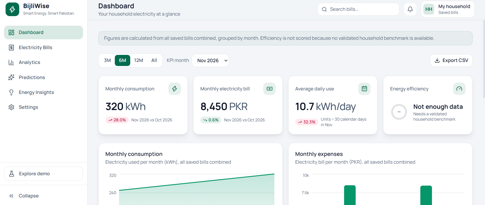
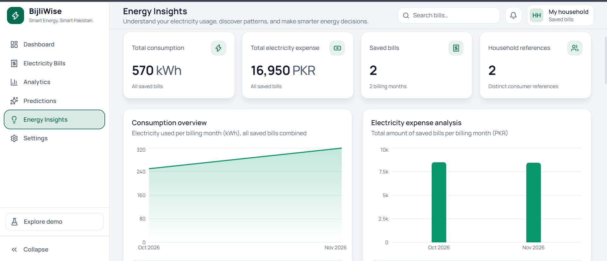
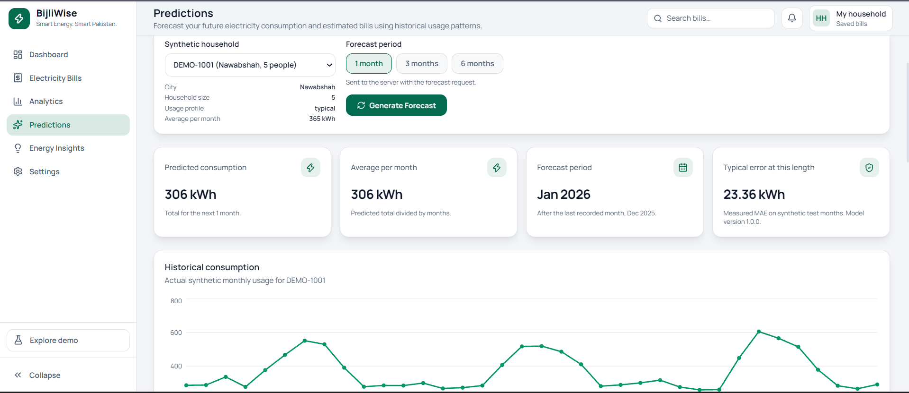
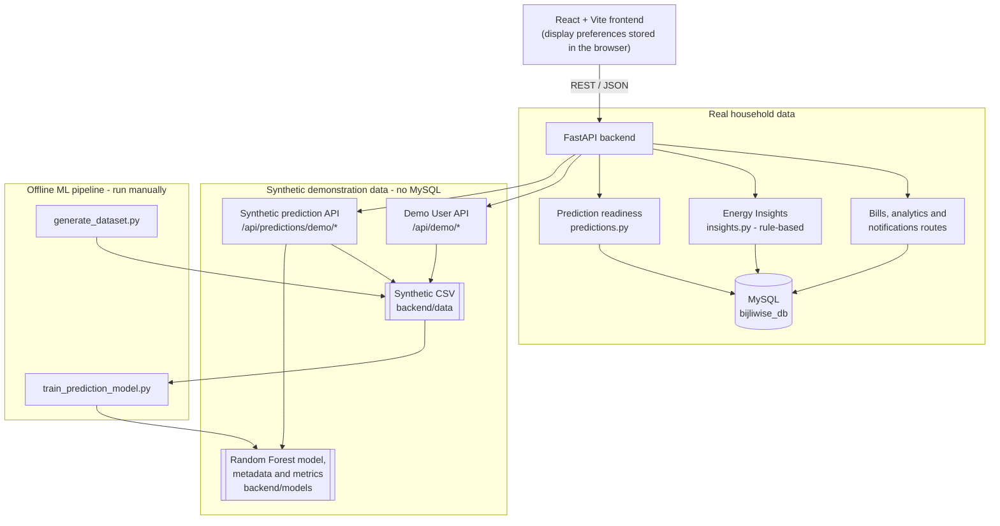
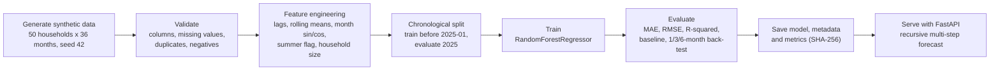

<div align="center">

# BijliWise

### Smart Energy. Smart Pakistan.

AI-Powered Household Electricity Consumption Analysis and Forecasting System


*Introduction to Data Science project — BS Information Technology*
*Shaheed Benazir Bhutto University, Shaheed Benazirabad, Sindh, Pakistan*

[Repository](https://github.com/asfandyarinsights-web/BijliWise) · [GitHub Pages (static frontend)](https://asfandyarinsights-web.github.io/BijliWise/) · [Setup guide](#installation-and-setup) · [API reference](#api-reference)

</div>

---

## Contents
1. [Overview](#overview)
2. [Key Features](#key-features)
3. [Application Screenshots](#application-screenshots)
4. [Real Household Data vs Synthetic Demo Data](#real-household-data-vs-synthetic-demo-data)
5. [Application Modules](#application-modules)
6. [System Architecture](#system-architecture)
7. [Technology Stack](#technology-stack)
8. [Project Structure](#project-structure)
9. [Data Science Methodology](#data-science-methodology)
10. [Dataset Generation and Preprocessing](#dataset-generation-and-preprocessing)
11. [Feature Engineering](#feature-engineering)
12. [Machine Learning Model](#machine-learning-model)
13. [Training and Evaluation](#training-and-evaluation)
14. [Installation and Setup](#installation-and-setup)
15. [Database Configuration](#database-configuration)
16. [Running the Application](#running-the-application)
17. [API Reference](#api-reference)
18. [Deployment and Academic Demonstration](#deployment-and-academic-demonstration)
19. [Limitations](#limitations)
20. [Future Improvements](#future-improvements)
21. [Author and Academic Information](#author-and-academic-information)

## Overview
Electricity is a major recurring household expense in Pakistan, and consumption changes strongly with the season because of summer cooling. Most households see only a monthly bill, with little view of long-term patterns or of what the coming months may look like.

**BijliWise** helps households record and understand their electricity consumption. It combines bill management, historical analytics, explainable energy insights, notifications and machine-learning-based consumption forecasting in one web application. It is designed to demonstrate how data analysis and machine learning can help consumers understand their electricity usage.

> [!IMPORTANT]
> The forecasting model is trained and evaluated on a **synthetic** dataset. The synthetic data is not real utility-provider data and is not a representative sample of Pakistani households. The reported accuracy does not prove real-world forecasting performance.

## Key Features
- **Bill management:** add, view, edit and delete electricity bills, with duplicate protection per consumer and billing month.
- **Dashboard and analytics:** monthly consumption and expense statistics with selectable reporting periods and CSV export.
- **Explainable Energy Insights:** rule-based calculations on saved bills (no machine learning), with data-quality checks.
- **AI Predictions:** Random Forest forecasts of monthly consumption for 1, 3 or 6 months, on synthetic demonstration households.
- **Notifications:** stored alerts for new bills, overdue bills and unusual consumption.
- **Demo User mode:** a separate, read-only synthetic profile that works without MySQL.
- **Settings:** theme, date format and default reporting period, stored in the browser.

## Application Screenshots
Screenshots of the running application. Each shows the top of the page.

| Dashboard | Energy Insights |
|---|---|
|  |  |
| *KPI cards for consumption, bill and daily use, with monthly charts. Based on two saved bills (October and November 2026) in the local database.* | *Summary cards and charts for all saved bills, using the same two bills.* |


*AI Predictions for the synthetic household DEMO-1001: forecast period selector, 1-month forecast (January 2026), the model's typical error (MAE 23.36 kWh on synthetic test months) and the historical consumption chart. Synthetic demonstration data.*

## Real Household Data vs Synthetic Demo Data
BijliWise handles two separate kinds of data. They are never mixed.

| | Real household data | Synthetic demo data |
|---|---|---|
| What it is | Bills that a user enters into the application | Fictional households generated by `backend/generate_dataset.py` |
| Stored in | MySQL (`electricity_bills`, `notifications`) | CSV file in `backend/data/` (not in MySQL) |
| Used by | Dashboard, Bills, Analytics, Energy Insights, Notifications | AI Predictions, Demo User mode (`DEMO-1001`) |
| Editable in the app | Yes | No. Read-only |
| Needs MySQL | Yes | No. The demo endpoints do not open a database connection |
| Forecasting | Readiness check only (no model is connected) | Random Forest forecasts |

> [!NOTE]
> Demo data is illustrative. It is not actual electricity consumption from Pakistani consumers or utility companies, and demo bill amounts are not an official electricity tariff.

## Application Modules

### 1. Dashboard
A household electricity overview calculated from all saved bills combined, grouped by month. It shows KPI cards for monthly consumption (with the change from the previous month), monthly electricity bill, average daily use and energy efficiency. Energy efficiency is deliberately not scored ("Not enough data") because no validated household benchmark exists. Monthly consumption and expense charts, 3M / 6M / 12M / All period filters, a KPI-month selector and CSV export complete the page.

### 2. Bills Management
Full create, read, update and delete for electricity bills (`/api/bills`).
- Stored fields: consumer reference, billing month, units consumed, total amount, issue date, due date, payment status (`Paid`, `Unpaid`, `Overdue`).
- Validation: units must be greater than 0 and the amount cannot be negative.
- A second bill for the same consumer reference and billing month is rejected (HTTP 409).
- Saving a bill, or changing it to Overdue, creates a notification.

### 3. Analytics
Monthly consumption and expense analysis. `GET /api/analytics/monthly` aggregates total units, total expense and bill count for each billing month in chronological order, enabling historical comparisons between months, household-level summaries and selectable reporting periods in the interface.

### 4. Energy Insights
Implemented in `backend/insights.py` and served by `GET /api/insights/energy`. It is **rule-based arithmetic on saved bills, not machine learning**, and it makes no forecast.

| Output | Description |
|---|---|
| Totals | Total recorded consumption and total recorded expense |
| Monthly analysis | Units, expense, bills and households per month |
| Household analysis | Per household: bill count, totals, averages, first and last month, change from its previous bill |
| Usage patterns | Highest and lowest consumption, highest and lowest bill, average units and expense per bill |
| Average cost per kWh | Total recorded amount divided by total recorded units. **Not an official tariff calculation** |
| Payment summary | Paid, Unpaid and Overdue counts and amounts, and the outstanding amount (Unpaid plus Overdue) |
| Unusual consumption | A household's latest bill is flagged when it is more than **25%** above the average of that household's earlier bills |
| Data quality | Skipped (invalid) records are counted; messages explain what can and cannot be concluded |

Rules: household trends need at least **2** bills for the same household; the unusual-consumption check needs at least **4**. Each household is compared only with its own history. Month-to-month totals are treated as comparable only when exactly the same household references appear in every month.

### 5. AI Predictions
Electricity consumption forecasting with a Random Forest regression model, on **synthetic demonstration households** (see [Data Science Methodology](#data-science-methodology)). The user chooses a household, a 1-, 3- or 6-month period and presses **Generate Forecast**. The page shows the predicted consumption, the monthly average, the forecast period, the model's typical error and the household's historical consumption.

The backend (`backend/demo_predictions.py`) verifies the model file's SHA-256 checksum and scikit-learn version before loading it, then produces recursive multi-step forecasts.

> [!WARNING]
> The synthetic model is separate from the real-household workflow. For bills saved in MySQL, `backend/predictions.py` only reports **forecasting readiness** (at least 12 monthly observations plus a trained and validated model). No model is currently connected to that workflow (`load_model()` returns none), so saved households do not receive forecasts. Not every household has a valid forecast.

### 6. Notifications
Stored in the MySQL `notifications` table by `backend/notifications.py`.

- Categories: Bill, Energy, Prediction, System.
- Created by real events: a bill is saved, a bill becomes Overdue, or a household's newest bill is more than 25% above or below the average of its previous 3 saved bills (only when at least 3 earlier bills exist).
- Duplicate notifications for the same event are prevented with a `dedupe_key`.
- Actions: list, unread count, mark one as read, mark all as read, delete one, clear all. Every action accepts an optional `consumer_reference` filter.
- A notification problem never causes a bill save to fail.

Demo User notifications are generated separately and are **not** stored in the real notifications table.

### 7. Demo User Mode
A separate, read-only synthetic demonstration environment, opened with the **Explore demo** button in the sidebar.
- Fictional household `DEMO-1001` with 36 months of synthetic bills, demo analytics, demo energy insights and demo notifications.
- Data is deterministic (identical on every request) and comes from the synthetic CSV, so it needs no MySQL.
- Demo bill ids start at 900000 so they cannot collide with real ids.
- No write operations: POST, PUT, PATCH and DELETE are not available on `/api/demo/*`, and real MySQL bills are never modified.

### 8. Settings
| Section | Options |
|---|---|
| Appearance | Light, Dark, Black / OLED and System themes |
| Regional preferences | Currency fixed to PKR and energy unit fixed to kWh; date format Short, `DD/MM/YYYY` or `YYYY-MM-DD` |
| Dashboard preferences | Default reporting period: 3 months, 6 months, 12 months or All |
| Data and privacy | Bills are stored in MySQL; CSV exports are generated in the browser and downloaded to the device; theme, date format and default period are stored in the current browser, not in MySQL |
| Profile and about | Shows a "Demo User" or "My household" placeholder and the application version, and states that there is no sign-in or account system yet |
| Reset | Restores preferences to their defaults. It does not delete bills or other database records |

The profiles are placeholders, not authenticated user accounts.

## System Architecture


| Layer | Responsibility |
|---|---|
| React frontend | User interface, charts, display preferences, CSV export |
| FastAPI backend | REST API, validation, Energy Insights, notifications, prediction services |
| MySQL | Real household bills and notifications only |
| Synthetic CSV + Random Forest model | Demonstration forecasting; not stored in MySQL |
| Demo User API | Separate read-only synthetic environment |

## Technology Stack
| Layer | Technologies |
|---|---|
| Frontend | React, Vite, Tailwind CSS v4, Recharts, Lucide React |
| Backend | Python, FastAPI, Uvicorn, PyMySQL, python-dotenv |
| Data science and ML | pandas, NumPy, scikit-learn (`RandomForestRegressor`), joblib |
| Database | MySQL (XAMPP for local development) |
| Tools | Git, GitHub, Visual Studio Code, FastAPI Swagger UI |

## Project Structure
Generated and ignored folders (`node_modules/`, `dist/`, virtual environments) are omitted. The frontend lives at the repository root; there is no `frontend/` folder.

```text
BijliWise/
├── src/                          # React application
│   ├── components/
│   ├── context/
│   ├── pages/
│   └── utils/
├── public/                       # static assets
├── backend/
│   ├── main.py                   # FastAPI app: bills, analytics, insights, prediction readiness
│   ├── database.py               # MySQL connection (PyMySQL), settings from .env
│   ├── create_tables.py          # database table initialisation script
│   ├── insights.py               # rule-based Energy Insights
│   ├── notifications.py          # notifications storage, API and event helpers
│   ├── predictions.py            # forecasting readiness for saved bills
│   ├── demo_user.py              # read-only Demo User API
│   ├── demo_predictions.py       # synthetic forecasting API
│   ├── generate_dataset.py       # synthetic dataset generator and validator
│   ├── prediction_features.py    # feature engineering and recursive forecasting
│   ├── train_prediction_model.py # model training and evaluation
│   ├── test_demo_user.py         # Demo User API tests
│   ├── data/                     # generated: synthetic CSV, validation report
│   ├── models/                   # generated: model file, metadata, metrics
│   └── .env                      # local database settings (you create it; never committed)
├── screenshots/                  # images used in this README
├── package.json
├── package-lock.json
├── index.html
├── vite.config.js
├── eslint.config.js
├── .gitignore
└── README.md
```

## Data Science Methodology


| Stage | What is done | Implemented in |
|---|---|---|
| Problem formulation | Analyse household consumption and forecast monthly kWh | this section |
| Dataset generation | 50 synthetic households x 36 months, seed 42 | `generate_dataset.py` |
| Data validation | Column, missing-value, duplicate and negative checks | `validate_dataset` |
| Preprocessing | No imputation needed; values bounded at generation | `generate_dataset.py` |
| Feature engineering | Lags, rolling means, month sine / cosine, summer flag | `prediction_features.py` |
| Model training | Random Forest regression | `train_prediction_model.py` |
| Chronological evaluation | Train before 2025, test on 2025 | `train_prediction_model.py` |
| Performance comparison | Against a last-month baseline; 1, 3 and 6-month back-test | `models/model_metrics.json` |
| Deployment through an API | Forecast endpoints served by FastAPI | `demo_predictions.py` |

### Problem formulation
Households lack a simple way to see how their electricity consumption develops and what to expect next. The goal is to analyse historical consumption and forecast monthly consumption (kWh) to support better-informed usage decisions. Intended users are residential consumers and households who monitor their usage.

## Dataset Generation and Preprocessing

### Synthetic dataset generation
The forecasting dataset is **synthetic**, generated by `backend/generate_dataset.py` with NumPy and a fixed random seed (42).

- 50 fictional households x 36 monthly records = **1,800 records**, January 2023 to December 2025.
- Columns: `consumer_reference`, `billing_month`, `household_size`, `city`, `season`, `month`, `previous_month_consumption`, `units_consumed` (target, kWh), `usage_profile`.
- Household sizes 2-9, 10 Pakistani cities, three usage profiles (energy saver, typical, high cooling).
- Consumption is simulated from household size, city climate, usage profile, a summer-cooling and winter pattern, a small trend, random noise and occasional spikes, bounded to 40-1,500 kWh. In the generated file it ranges from 115.8 to 1,016.1 kWh (mean 325.9 kWh).

### Validation and preprocessing
- **Validation** (`validate_dataset`): checks required columns, missing values, duplicate household-months, fully duplicated rows, negative values and observations per household. Generation and training stop if a check fails. Result: 0 missing values, 0 duplicates, 0 negative values, 36 observations per household.
- **Missing values and cleaning:** no imputation or outlier removal is implemented, because the generated data did not need it.

## Feature Engineering
Features are built in `backend/prediction_features.py` from **past values only**, which avoids data leakage. Training and inference share the same code.

| Feature | Meaning |
|---|---|
| `lag_1`, `lag_2`, `lag_3` | Consumption 1, 2 and 3 months earlier |
| `roll_mean_3`, `roll_mean_6` | Rolling average of the previous 3 and 6 months |
| `month`, `month_sin`, `month_cos` | Calendar month and its cyclical (sine / cosine) encoding |
| `is_summer` | 1 for May to September |
| `household_size` | Number of people in the household |

At least 6 months of history are required for a feature row, so modelling rows start in July 2023 (1,500 rows in total). The categorical columns `city`, `season` and `usage_profile` are not model inputs.

## Machine Learning Model
`RandomForestRegressor` from scikit-learn. A Random Forest captures non-linear relations between recent usage and seasonality, works well on small tabular data, is robust to noise, needs no feature scaling and reports feature importance. Hyperparameters were fixed, not tuned, and no other algorithm was compared.

| Parameter | Value |
|---|---:|
| Number of estimators | 300 |
| Minimum samples per leaf | 2 |
| Maximum features | 0.7 |
| Random state | 42 |

## Training and Evaluation

### Chronological split
| Dataset | Period | Rows |
|---|---|---:|
| Training | July 2023 - December 2024 | 900 |
| Evaluation | January 2025 - December 2025 | 600 |

A chronological split tests the model only on months after its training data, as in real forecasting. A random split would let the model learn from months that come after the ones it is tested on and give over-optimistic results.

### Recursive multi-step forecasting
The model predicts one month ahead. For a 3- or 6-month forecast, each prediction is appended to the household's history and the features are rebuilt to predict the next month, until the horizon is reached.

### Evaluation
Results on the held-out year 2025 (synthetic data), from `backend/models/model_metrics.json`. Retraining with the provided scripts and seed reproduced these values.

| Metric | Random Forest | Last-month baseline |
|---|---:|---:|
| MAE (kWh) | 23.36 | 41.78 |
| RMSE (kWh) | 33.26 | 61.93 |
| R² | 0.936 | 0.778 |
| MAPE (%) | 6.92 | 11.89 |

| Horizon | Model MAE | Model RMSE | Baseline MAE | Baseline RMSE |
|---|---:|---:|---:|---:|
| 1 month | 23.36 | 33.26 | 41.78 | 61.93 |
| 3 months | 30.40 | 42.97 | 75.83 | 109.52 |
| 6 months | 37.86 | 52.49 | 91.12 | 128.04 |

- **MAE** is the average absolute prediction error. Here it is about 23 kWh per household-month, roughly 7% of the 325.9 kWh average.
- **RMSE** also measures error but penalises large misses more strongly.
- **R²** is the share of variation in the evaluation target that the model explains: 93.6% for the model against 77.8% for the last-month baseline.
- Error grows with the forecast horizon because later steps build on earlier predictions, but it stays below the baseline in this back-test.
- The most important features are `lag_1` (about 63%), `roll_mean_3` (about 15%) and `month_cos` (about 8%).

> [!WARNING]
> These results come from simulated data with a clean seasonal structure. They do not demonstrate real-world accuracy. Real-world performance requires validation on suitable real electricity consumption data.

## Installation and Setup
Use **two separate terminals** while running the project: one for the backend and one for the frontend. Setup has three parts: this section (tools and dependencies), [Database Configuration](#database-configuration) and [Running the Application](#running-the-application).

### Prerequisites
- Python 3.10 or newer (the code uses `X | None` type syntax; the project was developed with Python 3.13)
- Node.js and npm
- XAMPP (MySQL) for the full application
- Git

### 1. Clone the repository
```bash
git clone https://github.com/asfandyarinsights-web/BijliWise.git
cd BijliWise
```

### 2. Frontend dependencies
From the project root (where `package.json` is):
```bash
npm install
```

### 3. Backend environment (PowerShell)
```powershell
cd backend
python -m venv venv
.\venv\Scripts\Activate.ps1
python -m pip install --upgrade pip
pip install fastapi "uvicorn[standard]" pymysql python-dotenv cryptography pandas numpy scikit-learn joblib
```
- If PowerShell blocks activation, run `Set-ExecutionPolicy -Scope Process -ExecutionPolicy Bypass` in that window and activate again.
- The repository has no `requirements.txt`. The command above installs every package the backend imports. `cryptography` is needed by PyMySQL for MySQL 8's default login method. Once it works, you can create the file with `pip freeze > requirements.txt`.

## Database Configuration
The full application stores real household bills and notifications in MySQL. Demo User mode and AI Predictions do not use MySQL.

### 1. Start MySQL and create the database
1. Start **MySQL** in the XAMPP Control Panel.
2. Open phpMyAdmin (`http://localhost/phpmyadmin`) and create the database:
   ```sql
   CREATE DATABASE bijliwise_db;
   ```

### 2. Configure `backend/.env`
`backend/database.py` reads these variables with python-dotenv (defaults shown) and connects with PyMySQL (`utf8mb4`).

| Variable | Default |
|---|---|
| `DB_HOST` | `localhost` |
| `DB_PORT` | `3306` |
| `DB_USER` | `root` |
| `DB_PASSWORD` | empty |
| `DB_NAME` | `bijliwise_db` |

```env
DB_HOST=localhost
DB_PORT=3306
DB_USER=root
DB_PASSWORD=
DB_NAME=bijliwise_db
```

> [!CAUTION]
> Never commit `.env`. Keep it listed in `.gitignore`.

### 3. Create the tables
The database must exist first. In `backend`, with the virtual environment active:
```powershell
python create_tables.py
```
This initialises the `electricity_bills` table (id, consumer_reference, billing_month, units_consumed, total_amount, issue_date, due_date, payment_status, created_at), with a uniqueness constraint on consumer reference and billing month.

The `notifications` table is created automatically by the notifications module on its first request (`CREATE TABLE IF NOT EXISTS`; nothing is altered or dropped):

<details>
<summary>Notifications table definition (from <code>backend/notifications.py</code>)</summary>

```sql
CREATE TABLE IF NOT EXISTS notifications (
    id INT AUTO_INCREMENT PRIMARY KEY,
    consumer_reference VARCHAR(50) NULL,
    title VARCHAR(150) NOT NULL,
    message VARCHAR(500) NOT NULL,
    category ENUM('Bill', 'Energy', 'Prediction', 'System') NOT NULL,
    is_read TINYINT(1) NOT NULL DEFAULT 0,
    related_entity_id INT NULL,
    action_path VARCHAR(50) NULL,
    dedupe_key VARCHAR(150) NULL,
    created_at TIMESTAMP NOT NULL DEFAULT CURRENT_TIMESTAMP,
    UNIQUE KEY uq_notifications_dedupe (dedupe_key),
    KEY idx_notifications_household (consumer_reference, created_at),
    KEY idx_notifications_unread (is_read, created_at)
) DEFAULT CHARSET=utf8mb4;
```
</details>

## Running the Application

### 1. Generate the synthetic dataset and train the model
Needed for AI Predictions and Demo User mode (they do not need MySQL). In `backend`, with the virtual environment active:
```powershell
python generate_dataset.py        # writes data/synthetic_electricity_usage.csv and a validation report
python train_prediction_model.py  # writes models/consumption_model.joblib, model_metrics.json, model_metadata.json
```
Train on the same machine that runs the API. The API refuses to load a model trained with a different scikit-learn major.minor version, or a model file that does not match its saved checksum.

### 2. Start the backend (Terminal 1)
From `backend`, with the virtual environment active:
```powershell
python -m uvicorn main:app --reload
```
| Service | URL |
|---|---|
| Backend | http://127.0.0.1:8000 |
| Swagger documentation | http://127.0.0.1:8000/docs |
| Health check | http://127.0.0.1:8000/health |

### 3. Start the frontend (Terminal 2)
Open a **second** terminal in the project root:
```powershell
npm run dev
```
Open the address Vite prints, normally http://localhost:5173/. The backend accepts browser requests only from `localhost` and `127.0.0.1` on ports 5173 and 5175.

> [!NOTE]
> Both the frontend and the backend must be running. MySQL must also be running for database-dependent features (bills, dashboard, analytics, insights, notifications). Demo User mode and AI Predictions need only the backend and the generated dataset and model.

### 4. Quick check
```powershell
Invoke-RestMethod http://127.0.0.1:8000/health
Invoke-RestMethod "http://127.0.0.1:8000/api/predictions/demo/forecast/DEMO-1001?horizon=3"
```

### Tests (optional)
```powershell
pip install pytest httpx
python -m pytest
```

### Troubleshooting
| Problem | Fix |
|---|---|
| `ModuleNotFoundError: No module named 'dotenv'` | `pip install python-dotenv` |
| `'cryptography' package is required` | `pip install cryptography` |
| `Access denied` or `Unknown database` | Check `backend/.env`, that XAMPP MySQL is running and that `bijliwise_db` exists |
| Demo prediction endpoints return HTTP 503 | Run `python generate_dataset.py`, then `python train_prediction_model.py` |
| "Model was trained with a different scikit-learn version" | Retrain with `python train_prediction_model.py` |
| Browser shows a CORS error | Open the app at `http://localhost:5173` (or port 5175) |

## API Reference
The backend exposes **27 routes**. Interactive documentation is available at http://127.0.0.1:8000/docs. Responses are JSON and errors use FastAPI's `{"detail": "..."}` format.

### General (`main.py`)
| Method | Path | Description |
|---|---|---|
| GET | `/` | Welcome message and status |
| GET | `/health` | Health check |

### Bills (`main.py`, MySQL)
| Method | Path | Description |
|---|---|---|
| GET | `/api/bills` | All bills, newest billing month first |
| GET | `/api/bills/{bill_id}` | One bill (404 if not found) |
| POST | `/api/bills` | Create a bill (201; 409 if the consumer and month already exist) |
| PUT | `/api/bills/{bill_id}` | Replace a bill (404 or 409 on error; Overdue creates a notification) |
| DELETE | `/api/bills/{bill_id}` | Delete a bill (404 if not found) |

| Field | Type | Rule |
|---|---|---|
| `consumer_reference` | string | required, 1-50 characters |
| `billing_month` | date | required |
| `units_consumed` | number | required, greater than 0 |
| `total_amount` | number | required, 0 or more |
| `issue_date`, `due_date` | date | optional |
| `payment_status` | string | `Paid`, `Unpaid` or `Overdue` (default `Unpaid`) |

### Analytics and insights (`main.py`, MySQL)
| Method | Path | Description |
|---|---|---|
| GET | `/api/analytics/monthly` | Per month: `month`, `total_units`, `total_expense`, `total_bills` |
| GET | `/api/insights/energy` | Rule-based Energy Insights (`overview`, `monthly_analysis`, `household_analysis`, `usage_patterns`, `insights`, `data_quality`) |

### Real-household prediction readiness (`main.py`, MySQL)
| Method | Path | Description |
|---|---|---|
| GET | `/api/predictions/households` | Households with observation counts, the 12-observation requirement, allowed horizons and model status |
| GET | `/api/predictions/readiness/{consumer_reference}` | Readiness of one household (404 if it has no bills) |
| GET | `/api/predictions/forecast/{consumer_reference}?horizon=1\|3\|6` | `available: false` with the reason unless a validated model produced predictions (none is connected); 422 for another horizon |

### Notifications (`notifications.py`, MySQL)
All routes accept an optional `consumer_reference` query parameter (1-50 characters).

| Method | Path | Description |
|---|---|---|
| GET | `/api/notifications` | List (`limit` 1-100, default 50; `unread_only`) |
| GET | `/api/notifications/unread-count` | Unread count |
| PATCH | `/api/notifications/read-all` | Mark all as read |
| PATCH | `/api/notifications/{notification_id}/read` | Mark one as read |
| DELETE | `/api/notifications/{notification_id}` | Delete one |
| DELETE | `/api/notifications` | Clear notifications |

### Demo User (`demo_user.py`, read-only, no MySQL)
| Method | Path | Description |
|---|---|---|
| GET | `/api/demo/profile` | Fictional demo profile (`DEMO-1001`) |
| GET | `/api/demo/bills` | The 36 synthetic bills |
| GET | `/api/demo/analytics/monthly` | Monthly analytics of the demo bills |
| GET | `/api/demo/insights/energy` | Energy insights of the demo bills |
| GET | `/api/demo/notifications` | Computed demo notifications |

### Synthetic predictions (`demo_predictions.py`, CSV + saved model, no MySQL)
| Method | Path | Description |
|---|---|---|
| GET | `/api/predictions/demo/households` | The 50 synthetic households |
| GET | `/api/predictions/demo/history/{consumer_reference}` | Monthly history of one synthetic household |
| GET | `/api/predictions/demo/forecast/{consumer_reference}?horizon=1\|3\|6` | Recursive forecast (422 invalid horizon, 404 unknown household, 503 missing data or model) |
| GET | `/api/predictions/model-metrics` | Model name, version, periods, metrics and model card |

## Deployment and Academic Demonstration
| Item | Link |
|---|---|
| GitHub repository | https://github.com/asfandyarinsights-web/BijliWise |
| GitHub Pages | https://asfandyarinsights-web.github.io/BijliWise/ |

> [!IMPORTANT]
> GitHub Pages serves the **static frontend only**. It does not provide the FastAPI backend or the MySQL database, so features that need them do not work from the Pages site alone. The full-stack application is **not publicly deployed**.

For the instructor demonstration, the complete application is run locally with MySQL (XAMPP), the FastAPI backend and the React frontend, following the [setup guide](#installation-and-setup), [database configuration](#database-configuration) and [running instructions](#running-the-application).

## Limitations
1. No login, registration or authentication system.
2. Consumer references are not verified for ownership.
3. MySQL is configured locally; the full application is not hosted online.
4. The ML dataset is synthetic and is not real utility-provider data.
5. Synthetic evaluation metrics do not prove real-world forecasting accuracy.
6. Real-household forecasts depend on enough historical data and a ready model; at present no model is connected to saved households.
7. Energy Insights uses rule-based calculations, not machine learning.
8. Unusual-usage detection uses a fixed 25% comparison rule.
9. There is no official live electricity tariff integration.
10. Future bill amounts are not forecast; the ML workflow forecasts electricity consumption only.
11. Display preferences are stored per browser.
12. GitHub Pages does not host the backend or database.
13. Modelling: a single hold-out split, fixed hyperparameters and no model comparison; recursive forecasts accumulate error; tariffs, outages, appliances and real weather are not modelled.

## Future Improvements
These are possible future directions, not completed features.
- Authentication and account management
- Integration of a real-world electricity consumption dataset
- Improved forecasting using more real historical data
- Model comparisons and more advanced evaluation
- Official tariff integration
- Cloud-hosted backend and database
- More advanced energy analytics
- Enhanced household energy recommendations

## Author and Academic Information
| | |
|---|---|
| Author | AsfandYar Chandio |
| Degree | BS Information Technology |
| Department | Department of Information Technology |
| University | Shaheed Benazir Bhutto University, Shaheed Benazirabad, Sindh, Pakistan |
| Course | Introduction to Data Science (project-based assignment) |
| Repository | https://github.com/asfandyarinsights-web/BijliWise |
